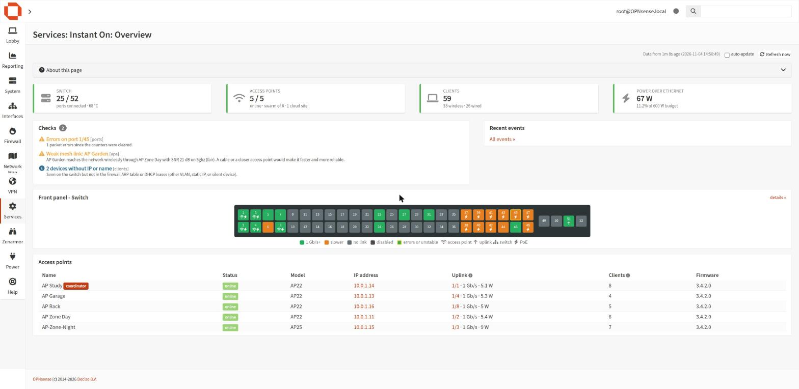
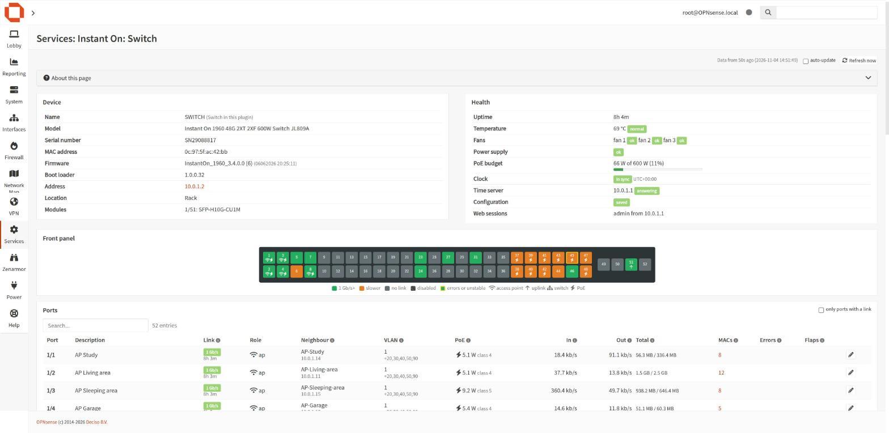
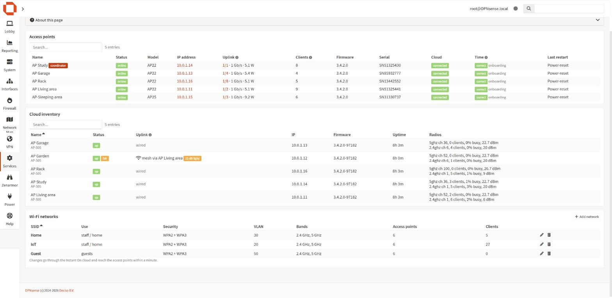
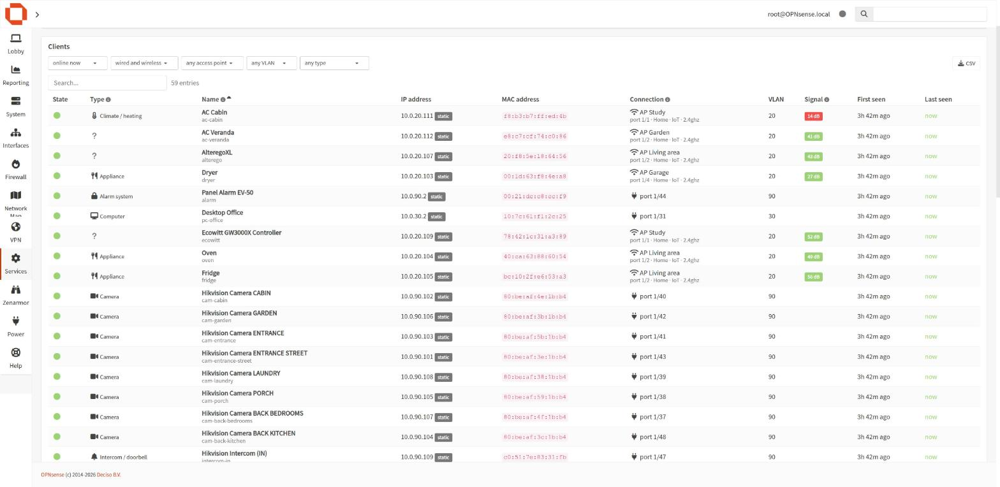
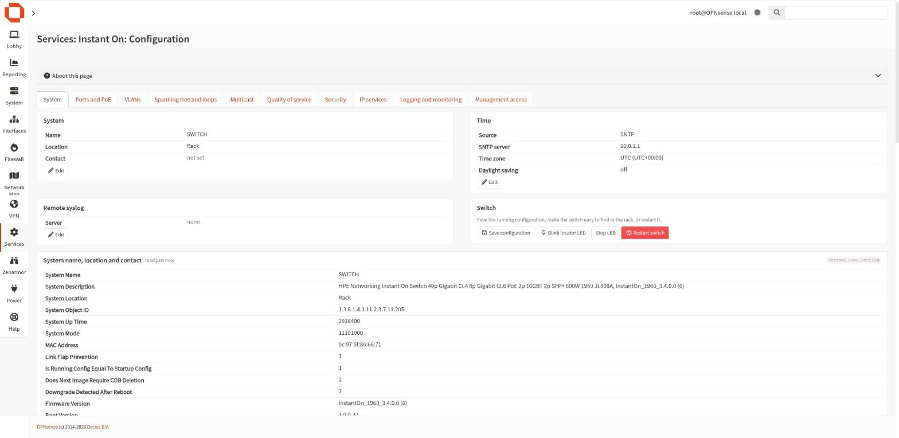

<p align="center"></p>

<h1 align="center">os-instanton</h1>

<p align="center">Monitor and manage HPE Networking Instant On switches, access points and Wi-Fi networks from OPNsense.</p>

<p align="center"></p>

## Overview

os-instanton brings an Instant On network into the OPNsense web interface
(**Services > Instant On**): the switches in local management mode, the
access points, the clients behind them and, optionally, the Instant On
cloud account. It correlates what the switch learns with the firewall's
ARP table and DHCP leases, so every port and every client has a name.

By default it only reads. Changes are enabled in Settings and are guarded
so that the link between the firewall and the switches cannot be cut by
mistake.

## Features

| Page | Content |
|---|---|
| **Overview** | Status cards, health checks, recent events, front panel of each switch, access points |
| **Switch** | Device and health data (temperature, fans, PSU, PoE budget, clock, unsaved configuration), clickable front panel, every port with link, neighbour, VLANs, PoE, throughput, errors and flaps, VLAN table, switch log |
| **Access Points** | Model, uplink port and PoE, clients, firmware, coordinator, restart reasons; with a cloud account also radios, mesh links and the Wi-Fi networks |
| **Clients** | Every device with kind, name, IP, MAC and manufacturer, access point or switch port, VLAN, signal, first and last seen; filters and CSV export |
| **Events** | Port, access point, client and PoE events, also sent to syslog |
| **Configuration** | Every configuration section of the switch, grouped like its menus, with the common tasks (name, time, syslog, save, locator LED, restart) |
| **Dashboard widget** | Switches, access points, clients, PoE and open problems |

### Management (optional)

* **Ports**: description, enable, speed and duplex, PoE, PoE power cycle,
  cable test, untagged and tagged VLANs.
* **VLANs**: create, rename, delete.
* **Wi-Fi networks** (cloud account): create, edit and delete, including
  security, VLAN or NAT addressing, bands, access points, schedule,
  bandwidth limits and access restrictions.
* **Switch configuration**: system, time and time servers, remote syslog,
  and a generic editor for the sections the switch interface can change.

Safeguards: ports towards the firewall and between monitored switches,
the management VLAN and VLAN 1 are protected; sections that control access
to the switch (management address, accounts, certificates, firmware, ...)
are read-only; changes that can interrupt traffic ask for confirmation.
Every change is validated first and recorded in Events and syslog.

### Health checks

Wrong switch clock or unanswered time server, unsaved configuration,
unexpected restarts, temperature, fan and PSU alarms, PoE budget, unstable
ports, packet errors, half duplex, slow access point uplinks, PoE faults,
unreachable access points, firmware crashes, weak mesh links, mixed
firmware and devices without address or name.

## Screenshots

| | |
|---|---|
|  |  |
|  |  |

## Requirements

* Instant On 1930 or 1960 switches in **local management** mode, with an
  account of their web interface (administrator rights to make changes).
* Instant On access points reachable from the firewall (their local
  diagnostic page on port 8080).
* Optional: an Instant On cloud account without two-factor
  authentication, for wireless client details, alerts and Wi-Fi network
  management. The cloud API is not documented by HPE; it is used the same
  way the Instant On portal uses it.

Works with any number of switches and cloud accounts (and sites).

## Privacy

* No telemetry, analytics or tracking of any kind.
* Switches and access points are reached on the local network only.
* The only connections outside the local network go to the HPE Instant On
  cloud (`portal.arubainstanton.com`, `nb.portal.arubainstanton.com`,
  `sso.arubainstanton.com`), and only when a cloud account is configured.
* Credentials are stored in the firewall configuration and in a generated
  file readable by root only. Wi-Fi passphrases returned by the cloud are
  never stored or sent to the browser.

## Installation

### From the package repository

```sh
fetch -o /usr/local/etc/pkg/repos/instanton.conf \
    https://raw.githubusercontent.com/itsjustdeepred/os-instanton/main/packaging/instanton.conf
pkg update -r instanton
pkg install os-instanton
```

The plugin then also appears in **System > Firmware > Plugins** and is
updated with the firewall. Packages are built for FreeBSD 14 and 15
(OPNsense community and business releases).

### From source

```sh
git clone https://github.com/itsjustdeepred/os-instanton.git
cd os-instanton && sh install.sh   # as root; sh uninstall.sh removes it
```

Then open **Services > Instant On > Settings**, add the switches and
optionally the cloud accounts, press **Test connection**, tick **Enable
monitor** and **Apply**.

### Network Map

[os-netmap](https://github.com/itsjustdeepred/os-netmap) uses this plugin,
when installed, to show the physical topology and how each device is
connected.

## Technical reference

### Data sources

* **Switch** – the web API of the switch (`/device/wcd?{Section}`), with
  the same RSA-encrypted login as its web interface. One session is kept
  open between polls so the switch log is not flooded with logins.
* **Access points** – the local diagnostic page
  `http://<ap>:8080/swarm.cgi?opcode=smb_debug_info`, found through the
  LLDP neighbours of the switch or listed by address.
* **Firewall** – ARP table, ISC, Kea and Dnsmasq leases and static
  mappings name the MAC addresses learned by the switch.
* **Cloud** – the Instant On portal API (OAuth2 with PKCE).

### Files and services

| Path | Purpose |
|---|---|
| `/usr/local/etc/rc.d/instanton` | Monitor service (`daemon(8)` + `collect.py --loop`) |
| `/usr/local/etc/instanton/instanton.conf` | Generated settings, mode 0600 |
| `/var/db/instanton/state.json` | Latest snapshot |
| `/var/db/instanton/clients.json` | Device history (first/last seen) |
| `/var/db/instanton/events.json` | Event history |
| `/var/db/instanton/config-<switch id>.json` | Switch configuration sections read for the Configuration page |
| `/var/log/instanton/` | Syslog output (Services > Instant On > Log File) |

configd actions: `instanton start|stop|restart|status|refresh|test`,
`instanton view <summary|switch|ports|aps|clients|events|log|insights|topology|all>[:<switch id>]`,
`instanton readconfig [<switch id>:]<group|Section|all|cached>`,
`instanton configure <base64url JSON request>`, `instanton cloudsites <account id>`,
`instanton cloudnet <base64url JSON request>`.

API:

```
GET  /api/instanton/status/{summary,aps,clients,events,insights,topology}
GET  /api/instanton/status/{switch,ports,log}/<switch id>
GET  /api/instanton/settings/get        POST /api/instanton/settings/set
     /api/instanton/settings/{search,get,add,set,del,toggle}{Switch,Account}
POST /api/instanton/service/{start,stop,restart,reconfigure,refresh,test}
POST /api/instanton/service/cloudsites/<account id>
GET  /api/instanton/service/status
GET  /api/instanton/config/read/<switch id>/cached   POST /api/instanton/config/read/<switch id>/{group|Section|all}
POST /api/instanton/config/apply         request={"switch": <id>, "action": ..., "params": {...}}
GET  /api/instanton/cloud/networks/<account id>/<site id>
POST /api/instanton/cloud/save/<account id>/<site id>     id=<network id or empty>, network=<JSON>
POST /api/instanton/cloud/delete/<account id>/<site id>/<network id>
```

Actions: `port`, `vlans` (port membership), `vlan` (create, rename,
delete), `poe`, `poe_cycle`, `system`, `time`, `syslog`, `locate`,
`cable_test`, `reboot`, `save`, `section` (generic: `section`, `op`
set/add/delete/deleteAll, `values` or `entries`, `confirm`). The ACL
*Services: Instant On: change switch* grants `config/apply` and the cloud
changes; the base ACL only reads.

`refresh` asks the running monitor to poll at once (SIGUSR1), or runs one
poll when the monitor is stopped. It also appears in the cron job action
list for scheduled polls without the background service.

## Tested with

* OPNsense 26.10 (FreeBSD 15.1)
* Instant On 1960 48G 2XT 2XF switch (JL809A), firmware 3.4.0.0
* Instant On AP22 and AP25 access points, firmware 3.4.2.0
* Instant On cloud account with one site

Other models and firmware versions should work but have not been tested
yet. Feedback, suggestions and pull requests are welcome, especially
reports from other switch and access point models.

## Development

The collector runs on any machine with Python 3.11+ and no extra modules:

```sh
INSTANTON_CONFIG=./instanton.conf INSTANTON_STATE_DIR=./state INSTANTON_DEBUG=1 \
    python3 src/opnsense/scripts/instanton/collect.py
python3 -m unittest discover -s tests
```

The tests use anonymized data and do not touch the network. Packages are
built by `packaging/build.sh` on FreeBSD and published by the GitHub
workflow on every `v*` tag.

## Disclaimer

HPE, Aruba and Instant On are trademarks of Hewlett Packard Enterprise.
This project is independent and not affiliated with or endorsed by HPE.

## License

BSD 2-Clause, the license used by OPNsense. See [LICENSE](LICENSE).
